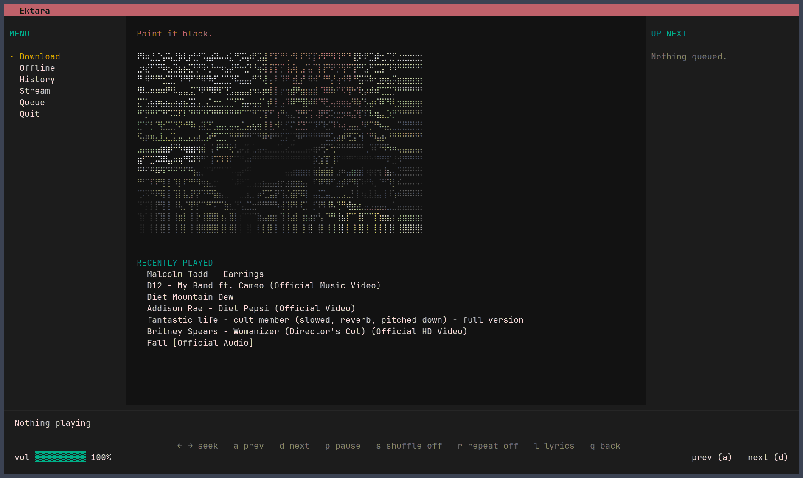

# ektara

A terminal music player. Plays mp3s from your library and streams from YouTube,
follows the lyrics while the song plays, and shows what you're listening to as a
Discord rich presence.

**Verified only for Linux. Windows users run at their own will.**

[](https://www.youtube.com/watch?v=oi4zRFjE2DE)

## Install

```sh
curl -fsSL https://raw.githubusercontent.com/korrykatti/ektara/main/install.sh | sh -s -- v0.1.0
```

Builds `v0.1.0` into `~/.local/bin`; swap the tag for a newer release.

<details>
<summary>Other install options</summary>

Current `main`:

```sh
curl -fsSL https://raw.githubusercontent.com/korrykatti/ektara/main/install.sh | sh
```

Or set the version (an argument wins):

```sh
curl -fsSL https://raw.githubusercontent.com/korrykatti/ektara/main/install.sh | EKTARA_VERSION=v0.1.0 sh
```

`wget -qO- <same URL> | sh -s -- v0.1.0` also works. `BINDIR` changes the
destination; `--install-deps` installs missing packages (not Go).

To inspect first (piping a remote script into `sh` is remote code execution):

```sh
curl -fsSLO https://raw.githubusercontent.com/korrykatti/ektara/main/install.sh
less install.sh
sh install.sh v0.1.0
```

The script still comes from `main`; pin its URL to pin both halves.

</details>

## Requirements

- Go 1.27+, and a C compiler (cgo, which `go-sqlite3` needed anyway)
- **libmpv 0.37+**, for playback:
  - Debian, Ubuntu: `libmpv2` (runtime), `libmpv-dev` (build)
  - Arch: `mpv`
  - Fedora: `mpv-libs` (runtime), `mpv-devel` (build)

  To avoid the dev headers, build with `-tags nocgo` and libmpv is loaded at
  runtime instead. Without cgo at all the build works but the database won't.
  Debian 12 ships libmpv 0.35.1, which is too old.
- `ffmpeg`, only for downloading. Streaming and local files go through mpv.
- `yt-dlp` is downloaded automatically when first needed.

## Build and run

```sh
./build.sh run     # or: go build ./... && ./ektara
```

Library, history and log live under `~/.local/share/ektara` and
`~/.local/state/ektara`, so the folder you run from doesn't matter. Set
`XDG_DATA_HOME` to put the library elsewhere.

## Menu

Arrow keys or `j`/`k`, or type the number.

| | mode | what it does |
| --- | --- | --- |
| 1 | Download | search YouTube, save it, play the file |
| 2 | Offline | play an mp3 from your library |
| 3 | History | play something played before |
| 4 | Stream | stream from YouTube, writing nothing to disk |
| 5 | Queue | build a queue of several tracks, mixing any of the above |
| 6 | Quit | leave |

Only mode 5 gives more than one track, so `a` and `d` only move between tracks
when there's a queue. With one track, `d` returns to the menu.

## Keys

Playing: `p` pause, `←`/`→` seek 5s, `a`/`d` prev and next, `s`
shuffle, `r` repeat, `m` mute, `+`/`-` volume, `l` lyrics, `q` back to the
menu.

A list, or the search box: `↑`/`↓` or `k`/`j` move, `enter` picks, `esc` or `q`
cancels. While a track is still opening, `esc` is the only key that works.

The search box takes the song name. Press `tab` for an optional artist, which
narrows the YouTube search and also names the lyrics when the video title does
not.

`ctrl+c` quits from anywhere. Shuffle and repeat hold for the session.

## Lyrics

Press `l` on any screen but the search box. Words come from
[LRCLIB](https://lrclib.net), timed line by line when they have timings, and the
line being sung is picked out as the song plays. While the screen is open the
arrows scroll the words instead of seeking; `l`, `esc` or `q` closes it and goes
back to the screen it was opened from. Some recordings run a little off the
timings: with timed words showing, `+` makes the words appear later and `-` makes
them appear earlier, 0.1s per press (instead of changing the volume), and `r`
puts them back. A lookup that fails is tried three times and then not cached; "no
lyrics" and "instrumental" are real answers and are kept.

## Genres

Genres are best-effort. yt-dlp sometimes supplies them; when it does not, ektara
asks [MusicBrainz](https://musicbrainz.org) once for the track that is playing,
using the song and artist, and shows up to three under the title. An answer,
including "none", is remembered, so a track is not looked up again. Playback
never waits for the lookup, and old history is not backfilled: a track picks up
its genres the next time it plays. No match means no genre, not a guess.

## Files

`~/.local/share/ektara/music/` holds your mp3s, and `songs.db` holds your history
plus a cache of searches, lyrics and genres, so a repeated lookup doesn't ask
YouTube, LRCLIB or MusicBrainz again. The log
is `~/.local/state/ektara/ektara.log`. A stream writes nothing to disk.

A database from an older version, left in the folder you first ran the program
from, is copied across on first run.

## Known limits

A stream takes a few seconds to start: yt-dlp resolves a direct link, then there
is a deliberate 3s wait, because YouTube answers 403 for the first second or two
of a fresh link and a refusal is silent from mpv's side.

When YouTube rate-limits, a search falls back on an older cached answer rather
than erroring, and a stream that won't resolve is skipped. Requests are paced at
ten at once then one every five seconds.

A local file's length is unknown for the first moment, so the progress bar settles
a beat after the track starts.

Discord is optional and retried every ten seconds while something plays.

## Tests

```sh
go test ./...                          # no special requirements
EKTARA_AUDIO_TESTS=1 go test ./...     # also plays real audio
EKTARA_NETWORK_TESTS=1 go test ./...   # and goes to YouTube
```

The audio tests are skipped unless asked for, since a machine with no sound server
would fail them for reasons unrelated to the code. They're the only thing that can
say the audio path works, and have caught a deadlock in seeking and a use-after-free
at shutdown.

## Credits

`asciiart/` is a port of [go-ascii](https://github.com/nearlynithin/go-ascii) by
[nearlynithin](https://github.com/nearlynithin): the sampling, luminosity and
character ramp are theirs. The original is a `main` package that writes to stdout;
this is the same conversion as a library taking a width, so it can be drawn in a
TUI. Cover art is drawn in braille, two pixels per cell, which is what makes the
colour worth having.

```sh
git clone https://github.com/nearlynithin/go-ascii
cd go-ascii && go build -o go-ascii && ./go-ascii [-color] <image.png>
```

## License

GPL-2.0-or-later, see [LICENSE](LICENSE). ektara uses
[libmpv](https://mpv.io), which is GPL too.
